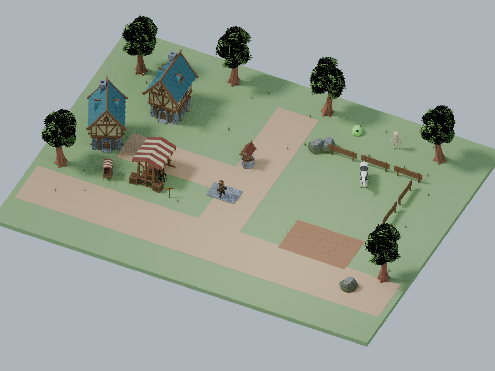

# P00 — Homologação técnica e direção artística

**Status: executada; aguardando aprovação visual do usuário.** 27/11/2026. Não é a implementação do MMORPG. O lote entrega inventário integral dos arquivos adquiridos, seleção amostral, critérios e prova técnica reproduzível; não promove automaticamente todos os candidatos a runtime.

## Entregas e evidências

- [Auditoria dos 33 pacotes](pack_audit.csv): SHA-256, CRC dos ZIPs, extensões, contagem de candidatos, documentos internos e caminhos inseguros.
- [Catálogo de candidatos](asset_catalog.csv): 1.813 linhas de models/áudio/UI/texturas, ID do pack, nome lógico, formato e caminho representativo. Os stems são deduplicados dentro de cada pack por família, não entre packs; os arquivos físicos permanecem nos ZIPs originais.
- [Inventário de ações](animation_inventory.csv): 433 ações/entradas encontradas em 48 membros-fonte, incluindo bibliotecas universais. Nomes não garantem qualidade, aplicação ao rig do avatar ou ausência de duplicação.
- [Evidência das licenças internas](license_review.md), [matriz de cobertura A01–A30](COVERAGE.md), [arquitetura técnica](ARCHITECTURE.md).
- [Manifesto dos 21 derivados](pilot_manifest.csv): membros originais, hash do pack, hash GLB, escala, triângulos, clipes, texturas e status.
- [Cena de Bravamar](pilot.png), [detalhe da vila](pilot-detail.png), [catálogo visual](contact-sheet.jpg), [animações](animation-preview.gif).
- [Projeto Godot executável](../../prototypes/p00/README.md), pipeline em [tools/p00](../../tools/p00), padrões em [AGENTS.md](../../AGENTS.md).

## Auditoria e resultado quantitativo

| Verificação | Resultado |
|---|---|
| Arquivos originais | 33/33 SHA-256 idênticos ao manifesto |
| Arquivos ZIP | 27/27 CRC válido, nenhum caminho de extração inseguro detectado |
| Arquivos internos contabilizados | 6.716 (exclui diretórios e metadados macOS) |
| Candidatos de modelo | 1.028 por stem por pack; não representam espécies distintas nem produção pronta |
| Entradas de áudio | 191 nomes por pack, incluindo trilhas |
| Entradas UI | 355 nomes por pack |
| Ações de fonte | 433 entradas / 48 membros-fonte |
| Evidência interna | 15 packs com texto CC0; 2 Kenney com CC0 interno e atenção a fontes/terceiros; 16 sem documento interno identificável, licença indicada na página original |
| GLBs convertidos | 21/21 válidos, dimensões alvo normalizadas, texturas embutidas e resolvidas |
| Animações | 51 clipes exportados, número conferido no JSON GLB; três séries de 12 frames renderizadas |
| Cena | 93 instâncias, 5 animadores, 86.302 triângulos brutos de instâncias (sem terreno; não é draw count/GPU benchmark) |
| Godot | importação headless e execução em 4.7.2 sem erros de script; P00_OK |
| Render | Blender 4.3.2, Cycles CPU; preview visual derivado dos GLBs e layout reais |

## Decisões artísticas

Esta é uma maquete de comparação, não o mapa final da cidade. Orientação original, composição em escala humana, arquitetura Q05, vegetação Q11, ferramentas Q12, cultivo Q08, figuras Q01 e Q04. O chão retangular e caminhos simples são suporte técnico da maquete; Bravamar final requer topografia orgânica, decoração, materiais de chão, gramado denso, marcos, layouts próprios e interação. A câmera angular pode ser inspecionada no Godot. A cena usa dois edifícios deliberadamente repetidos para comparação de orientação; não é aprovação de repetição no mapa final.

- **Base**: Quaternius Q01/Q04/Q05/Q07/Q08, materiais estilizados; Q11/Q12 Standard aceitos como candidatos após normalização. Texturas Q11 originalmente dependem de shader não fornecido no Standard; adotado fallback PBR e tintura de folhas com alpha preservado. LODs e instancing devem ser refinados em produção.
- **Rejeição visual**: Q19 Deer e Chicken têm corpo extremamente compacto/forma de cabeça de criatura, diferente da fauna Q07. Foram removidos da cena; permanecem no catálogo e nos GLBs de QA para comparação. Não promovê-los ao runtime; criar veado/galinha consistentes ou adquirir candidato compatível. Outros Q19 precisam revisão individual, não exclusão cega do pack.
- **Humanoides**: Monk e Ranger apresentam roupa e arma próprias; referência de proporção estilizada e rig, não avatar modular final. Ranger possui arco incorporado à fonte de preview, inadequado a um NPC mercador final. O avatar de jogo terá roupa independente do equipamento, duas bases, acessórios destacáveis e sockets. Monk tem 6.714 tris (acima da meta de 6k), árvore 6.265, casa 5.758; otimização posterior. Não iniciar produção com as proporções dos humanos aprovadas implicitamente.
- **Cultivo**: Wheat_Crop é colhido/feixe deitado. Wheat_4 é planta em pé; piloto usa 32 plantas individuais como teste de escala. Produção usa clusters/instancing. Paver mede aproximadamente 0,79 × 0,78 m no piloto; espaçamento 0,80 m.
- **Ferramenta**: Bronze é exemplo do catálogo, não substitui T1 de madeira do GDD. Q16/Q17/Q14 incluem objetos modernos; filtrar, não importar indiscriminadamente.
- **Bosses**: os dez designs próprios não existem nos packs; sem substituição por escala de mob comum. Matriz de cobertura define as lacunas.

## Correções da pipeline verificadas

1. FBX antigos: texturas Q01/Q19 não entravam automaticamente; relink explícito pelo arquivo do pack. Materiais de alguns FBX tinham alpha 0; normalizado para opaco no piloto. Q03 poção usa aproximação PBR opaca (vidro e líquido final pendentes).
2. Q12: glTF referenciava atlas em outra pasta; a cópia para scratch resolve os links sem alterar fonte. Export GLB inclui imagens, não depende de arquivos externos.
3. Q11: cor/vertex attributes do shader original causavam escurecimento. Fallback conserva silhueta/máscara e ajusta cor; árvores ainda precisam revisão de folhas e LOD, sem prometer melhor aparência em todos os renderers.
4. Animação: FBX importava várias actions, mas export automático inicial gravava somente uma. NLA explícito por clipe exporta todos os nomes (51/51); Blender avisou >4 influências de peso em alguns vértices, reduziu às 4 maiores. Revisão de deformations, foot sliding e sockets ainda obrigatória.
5. Wheat_Crop deitado substituído pelo estágio Wheat_4. Corrigido espaçamento de pavers para evitar sobreposição.
6. Draco indisponível no Blender instalado; GLBs sem Draco são válidos. Render sem OpenImageDenoise (build sem suporte); preview Cycles 24 samples. Nenhuma dessas limitações bloqueou importação.

## Execução e aprovação

Para testar a prova: abrir o projeto em Godot 4.7.2, importar os GLBs e executar F6/F5; setas esquerda/direita giram, cima/baixo zoom, Espaço pausa Idle. Não há personagem controlável, interação, login, servidor ou combate nesta etapa. O GIF é uma amostra de frames do GLB; não medida de fluidez em jogo. As 51 animações não estão homologadas frame a frame.

**Critérios cumpridos:** audit completo da coleção adquirida, catálogo de ações por nome, cobertura e lacunas, pipeline reproduzível com 21 GLBs, render visual comparativo, prova de importação Godot, arquitetura escolhida e AGENTS publicado.

**Pendências para aprovação e P0:** aprovação da direção artística pelo usuário; teste GUI/renderer e benchmark em hardware-alvo (headless não mede FPS); criar avatar neutro e rigs/colliders/LOD finais, fechar três famílias P0 de monstros ausentes, ferramentas T1, nós cobre/erva e UI inicial. Licenças de fontes e de quaisquer componentes internos de terceiros devem ser revisadas antes de promoção. Não foi feita audição individual das 191 entradas. Nenhum candidato foi promovido ao runtime de produção. P00 é entregue como etapa de pré-produção técnica, não aprovação automática da arte.
